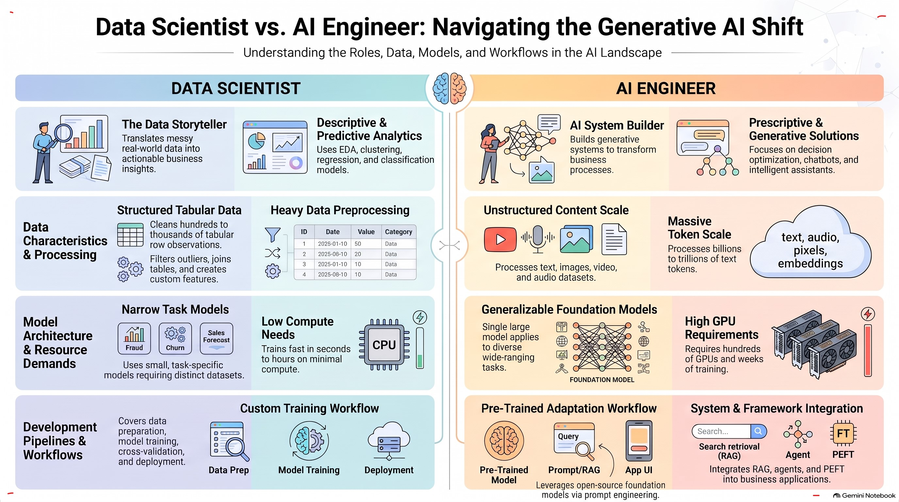

# Data Scientist vs. AI Engineer

An interactive, comprehensive guide and visual comparison dissecting the roles, responsibilities, technical stacks, workflows, and convergence between **Data Scientists** and **AI Engineers**.



---

## 🌐 Live Presentations & Demos

You can explore the interactive presentation online via either of the following links:

* 🚀 **Interactive Presentation (GitHub Pages):**  
  [https://mohamed-soubhi.github.io/data-scientist-vs-ai-engineer/](https://mohamed-soubhi.github.io/data-scientist-vs-ai-engineer/)

* 🖥️ **Full-Page Embedded View (Google Sites):**  
  [https://sites.google.com/view/data-scientist-vs-ai-engineer-/full-page-embed](https://sites.google.com/view/data-scientist-vs-ai-engineer-/full-page-embed)

---

## 📌 Overview

As artificial intelligence evolves from exploratory statistical analysis into real-time, LLM-powered autonomous production systems, a major role divergence has emerged. This project breaks down:

- **Why Did a New Role Emerge?** – Tracing the shift from statistical inference and tabular machine learning to foundation models and agentic software systems.
- **Core Skillsets & Mindsets** – Statistical rigor and scientific hypothesis testing vs. software engineering, systems design, and latency optimization.
- **Data Scale & Modalities** – Tabular, relational, and structured data vs. massive multi-modal, unstructured data, embeddings, and vector databases.
- **Compute & Architecture** – CPU/GPU model training pipelines vs. distributed GPU inference, quantization, orchestration, and LLM serving.
- **Workflows & Lifecycles** – Traditional **MLOps** (feature stores, drift detection, retraining) vs. modern **LLMOps / Compound AI** (RAG, prompt evals, synthetic data, guardrails, agent orchestration).
- **Summary Matrix & Field Convergence** – Where these disciplines overlap and how modern teams can balance both competencies.

---

## 🛠️ Project Structure

```text
├── index.html                                    # Main interactive presentation (Tailwind CSS, Dark Mode)
├── data_scientist_vs_ai_engineer_presentation.html # Presentation source HTML
├── Data_Scientist_vs_AI_Engineer.png             # High-resolution comparison visual (PNG)
├── Data_Scientist_vs_AI_Engineer.jpg             # High-resolution comparison visual (JPG)
└── README.md                                     # Project documentation and links
```

---

## 💻 Running Locally

To view the interactive presentation locally:

1. **Clone the repository:**
   ```bash
   git clone https://github.com/mohamed-soubhi/data-scientist-vs-ai-engineer.git
   cd data-scientist-vs-ai-engineer
   ```

2. **Open in browser:**
   - Simply double-click `index.html` to open it in your default web browser, or:
   - Use Python's built-in HTTP server:
     ```bash
     python3 -m http.server 8000
     ```
   - Then open `http://localhost:8000` in your browser.

---

## 🔗 Links

- **GitHub Pages:** [mohamed-soubhi.github.io/data-scientist-vs-ai-engineer](https://mohamed-soubhi.github.io/data-scientist-vs-ai-engineer/)
- **Google Sites Embed:** [sites.google.com/view/data-scientist-vs-ai-engineer-/full-page-embed](https://sites.google.com/view/data-scientist-vs-ai-engineer-/full-page-embed)
- **Repository:** [github.com/mohamed-soubhi/data-scientist-vs-ai-engineer](https://github.com/mohamed-soubhi/data-scientist-vs-ai-engineer)
